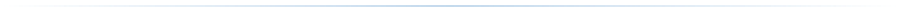

<div align="center">


<h3>Hi, I'm Eduard Rădeanu 👋</h3>



</div>



## 👨‍💻 About me

```python
class Eduard:
    role       = "Software Developer & Trader"
    background = "Mathematics & Computer Science"
    focus      = ["Local LLMs", "AI agents", "RAG", "Automation"]
    markets    = ["Stock indices", "FX"]
    motto      = "Measure first, then optimize."
```

## 🧠 Interests

<p align="center">
  
  
  
  
  
  
</p>


## 🛠️ Tech stack

<p align="center">
  
</p>

<p align="center">
  
  
  
  
</p>

<p align="center">
<picture>
  <source media="(prefers-color-scheme: dark)" srcset="https://raw.githubusercontent.com/EduardRadeanu/EduardRadeanu/output/github-snake-dark.svg">
  
</picture>
</p>


## 🚀 Currently building

Local AI tools, agent pipelines and trading analytics.

<p align="center">
  
</p>


## 📈 Trading

<p align="center">
  
</p>

- **Risk first:** fixed risk per trade, capital preservation over excitement
- **Every trade journaled:** setup, session and a post-mortem
- **Probabilistic thinking:** an edge plays out over many trades, not one
- **Data over gut feeling:** the same rigor I use in code


## 🕹️ Contributions

<picture>
  <source media="(prefers-color-scheme: dark)" srcset="https://raw.githubusercontent.com/EduardRadeanu/EduardRadeanu/output/pacman-contribution-graph-dark.svg">
  
</picture>
